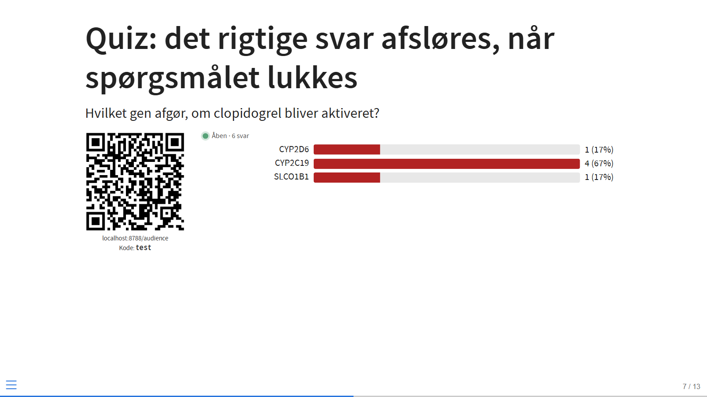
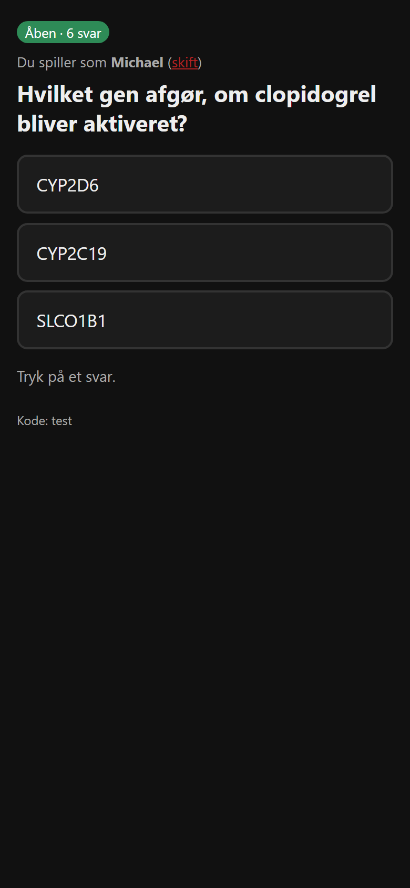

# quarto-poll

[](https://github.com/masger/quarto-poll/actions/workflows/test.yml)

Live audience polling and quizzes inside [Quarto](https://quarto.org) revealjs presentations. The audience scans a QR code on the slide, answers on their phone, and the slide updates in real time. No Mentimeter, no account for the audience, no server to run: votes go through a free [Firebase Realtime Database](https://firebase.google.com/docs/database) that you own.



Question types: single choice, multiple choice, scale, ranking, short text (word cloud) and open answers (cards). Any choice question with a `- [x]` option becomes a quiz question with points, an optional countdown with speed bonus, a leaderboard and a podium. Results can be hidden until you close the poll, shown again on a later slide and exported as CSV.

This extension was vibe coded with Claude (Anthropic) by Michael Asger Andersen. It has an end-to-end test suite that runs in GitHub Actions, but read the code before you trust it with anything important.

## Quick start

1. Set up Firebase once (see below) so you have a database URL, an API key and a presenter login.
2. In the folder of your presentation, install the extension:

   ```bash
   quarto add masger/quarto-poll
   ```

   This creates `_extensions/masger/poll`. The audience page is hosted at <https://masger.github.io/poll/>; it is a single static HTML file that you can also host yourself (see below).
3. Create `_poll.yml` in the same folder with your Firebase values (see *Configure*). The filter finds it by itself; you do not need `metadata-files`.
4. Add `filters: [poll]` to the deck and write the polls as below. Render with `quarto render my-talk.qmd` and open the HTML file. If `_poll.yml` has no password, the deck asks for it once and remembers the sign-in in that browser.

## Write a poll

```markdown
---
title: "My talk"
format:
  revealjs:
    filters: [poll]
---

## Most of us do not genotype before clopidogrel

::: {.poll #clopidogrel}
What do you do on Monday when a patient with a stent needs clopidogrel?

- Order a CYP2C19 genotype first
- Switch to ticagrelor without testing
- Give clopidogrel and wait
:::

## One word for pharmacogenetics today

::: {.poll #word type="text"}
One word that describes pharmacogenetics in your daily work
:::

## Results from the first question

::: {.poll-results poll="clopidogrel"}
:::
```

A `.poll` div holds one paragraph (the question) and an optional bullet list (the options). Without a list the poll is free text.

| Type | Markdown | The audience | The slide |
| --- | --- | --- | --- |
| `choice` (default with a list) | bullet list | taps one option | live bars |
| `multi` | `type="multi"` + list | selects several, taps Send | bars, one count per option |
| `scale` | `type="scale" min="1" max="5"` (list = labels) | taps a number | bars and the mean |
| `rank` | `type="rank"` + list | taps the options in order | options sorted by mean rank |
| `text` (default without a list) | no list | one short answer (80 characters) | word cloud |
| `open` | `type="open"` | a longer answer (300 characters) | cards |

Other attributes:

| Attribute | Meaning |
| --- | --- |
| `#id` | Poll id, used by `.poll-results` and in the database. Defaults to `poll1`, `poll2`, ... |
| `results="hidden"` | While the poll is open the slide shows only the number of answers. Close the poll to reveal the chart. |
| `auto="false"` | Do not open the poll when the slide appears; open it with the V key. |
| `time="30"` | Countdown in seconds on the slide and the phones; the poll closes by itself when the time is up. |

During the talk: the poll opens when its slide is shown and closes when you leave the slide (votes are kept). Keys:

| Key | Action |
| --- | --- |
| **V** | open or close the poll on the current slide |
| **X** | reset the votes on the current slide |
| **R** | reset every answer, all points and all names in the room (asks for confirmation) |
| **E** | download all answers in the room as a CSV file (one row per answer, with names, labels, response times and points) |

Votes stay in the database between talks, so press R before a new audience, or use a new room code.

## Quiz with points

Mark the correct option with a task-list checkbox:

```markdown
## Which gene activates clopidogrel?

::: {.poll #gene points="2"}
Which gene decides whether clopidogrel is activated?

- [ ] CYP2D6
- [x] CYP2C19
- [ ] SLCO1B1
:::

## Which drugs are affected by CYP2C19? (select all)

::: {.poll #drugs type="multi"}
- [x] Clopidogrel
- [ ] Metoprolol
- [x] Omeprazole
:::

## Type the gene

::: {.poll #typed type="text" answers="CYP2C19, CYP 2C19"}
Which gene do we test before clopidogrel?
:::

## Fast round: 20 seconds, up to 1000 points

::: {.poll #fast points="1000" time="20" speed="true"}
Which enzyme activates clopidogrel?

- [ ] CYP3A4
- [x] CYP2C19
- [ ] CYP2D6
:::

## Scores

::: {.poll-scores top="10"}
:::
```



How it plays: the first time a quiz question opens, the audience page asks for a name. The correct answer is not written to the database while the question is open, so nobody can look it up; it is revealed when you close the question (leave the slide, press V, or let the countdown run out). The slide then marks the correct answers in green and shows how many got it right, and each phone shows right or wrong, the player's total and the top five. `.poll-scores` shows a podium for the top three and the leaderboard (`top`, default 10; `podium="false"` hides the podium).

Points: `points` per correct answer (default 1). A `multi` quiz needs the exact set. A `text` quiz accepts any of the `answers`, ignoring case and extra spaces. With `time` and `speed="true"` a correct answer scores between the full points (answered at once) and half (answered at the last second); response times come from the database server's clock, so phones cannot cheat by changing their own. Use `points="1000"` for speed rounds so the bonus is visible. Players can change their answer while the question is open, and the last answer counts.

## Configure: `_poll.yml`

Create a file named `_poll.yml` next to your `.qmd` and add it to `.gitignore`:

```yaml
poll:
  db: https://YOUR-PROJECT-default-rtdb.europe-west1.firebasedatabase.app
  api-key: AIza...                # Firebase web API key (not a secret)
  email: presenter@example.com    # Firebase Authentication user
  password: "..."                 # optional: leave it out and the deck asks once per browser
  room: pgx26                     # short room code, unique per talk
  audience: https://masger.github.io/poll/
  audience-mode: stream           # or polling (see "Large audiences")
  color: "#B22222"                # bar and word colour
  lang: da                        # da or en, for the slide labels and the audience page
  close-on-leave: true
```

The filter reads this file verbatim, so any characters are fine in the password. You can also put a `poll:` block in the YAML header of the deck; header values win, and the file fills in the rest. Point to another file with `poll: {file: other.yml}` or switch the file off with `poll: {file: none}`. Header values are parsed as Markdown by Pandoc, so `$`, `*` and `_` in a password would be mangled there; keep the password in the file.

Without `password` the rendered deck contains nothing secret: when it opens it asks for the password once, signs in, and keeps a refresh token in that browser's local storage. You can then share the HTML file; others see the polls but cannot control them. With `password` set, the rendered HTML contains it, so do not publish that deck.

## Set up Firebase (once, about ten minutes)

You need four values: the database URL, the web API key, and the email and password of one presenter user.

1. **Create a project.** Go to <https://console.firebase.google.com>, **Add project**, any name, Analytics off.
2. **Create the database.** Left menu, **Build > Realtime Database > Create database**. Choose a location (for Europe: Belgium, `europe-west1`) and **Start in locked mode**. The **Data** tab now shows the database URL at the top, like `https://my-project-default-rtdb.europe-west1.firebasedatabase.app`. That is `db`.
3. **Publish the rules.** Open the **Rules** tab. It shows a small JSON document (`".read": false, ".write": false`), not YAML. Replace the whole thing with the contents of [`database.rules.json`](database.rules.json), change `PRESENTER_EMAIL` to the email you will create in step 4, and click **Publish**. When a new version of the extension changes the rules file, paste it again.
4. **Create the presenter login.** **Build > Authentication > Get started**. Under **Sign-in method** enable **Email/Password**. Under **Users**, **Add user** with an email and a password. They are `email` and `password`.
5. **Get the API key.** Click the gear next to **Project Overview**, **Project settings**. Scroll down to **Your apps**, click the web icon `</>`, give the app a nickname, leave Firebase Hosting unticked and click **Register app**. The page shows a `firebaseConfig` snippet; copy the `apiKey` value (starts with `AIza`). That is `api-key`. The rest of the snippet is not needed; the extension does not use the Firebase SDK.

What the rules do: anyone with the room code can read the polls and write one answer per device, only while the poll is open, only in the shape the question type allows, and for quiz questions only after registering a name. Only the signed-in presenter can create polls, open and close them, and reset votes. No personal data is stored: an answer is a random device id, the chosen name, an option index or a short text, and a server timestamp.

## Large audiences

The free Spark plan allows **100 simultaneous connections** to the database. A phone that listens to the live stream holds one. Set `audience-mode: polling` and the QR code sends phones to a mode where they fetch the state every two seconds instead (every five seconds between questions). That uses no persistent connection, so the limit does not apply, at the cost of a two-second delay on the phones; the slide still updates at once. Phones also switch to polling by themselves if the stream is refused. The Blaze (pay as you go) plan removes the limit and keeps the same free quota; a talk with a few hundred answers stays at zero cost.

## Host the audience page yourself

Copy `audience/index.html` to any static host and set `audience` to its URL. The page takes `?r=<room>&db=<database url>&l=<da|en>&m=<p for polling>` from the QR code, so one copy works for any database. Edit `DEFAULT_DB` in the file so that people who type the room code by hand reach your database.

## Develop and test without Firebase

```bash
node dev/test.js            # renders example.qmd, starts the mock database, runs 35 end-to-end checks
node dev/test.js --no-render --verbose
```

`dev/mock_firebase.py` imitates the parts of the Firebase REST API that the plugin uses (GET, PUT, PATCH, DELETE, server timestamps and event streaming) and serves static files. `dev/headless.js` drives a headless Edge or Chrome over the DevTools protocol; set `BROWSER=/path/to/chrome` if it is not found. The same suite runs in GitHub Actions on every push.

To try it by hand:

```bash
python dev/mock_firebase.py --port 8788 --static .
quarto render example.qmd
# open http://localhost:8788/example.html and http://localhost:8788/audience/?r=test&db=http%3A%2F%2Flocalhost%3A8788
```

## How it works

`poll.lua` turns each `.poll` div into a `<div class="quarto-poll">` with the question, options and settings in a `data-poll` JSON attribute, and injects the config as `window.QUARTO_POLL`. `poll.js` waits for Reveal, signs in to Firebase with the REST API, listens to `pub/<room>` as a server-sent event stream, writes the poll metadata when its slide appears and renders the chart on every update. The audience page listens to the same path (or polls it) and writes `pub/<room>/polls/<id>/votes/<device>`, plus `times/<device>` for speed rounds and `names/<device>` for quizzes. The QR code is generated in the browser with [qrcode-generator](https://github.com/kazuhikoarase/qrcode-generator) (MIT).

## Licence

MIT. Copyright 2026 Michael Asger Andersen.
